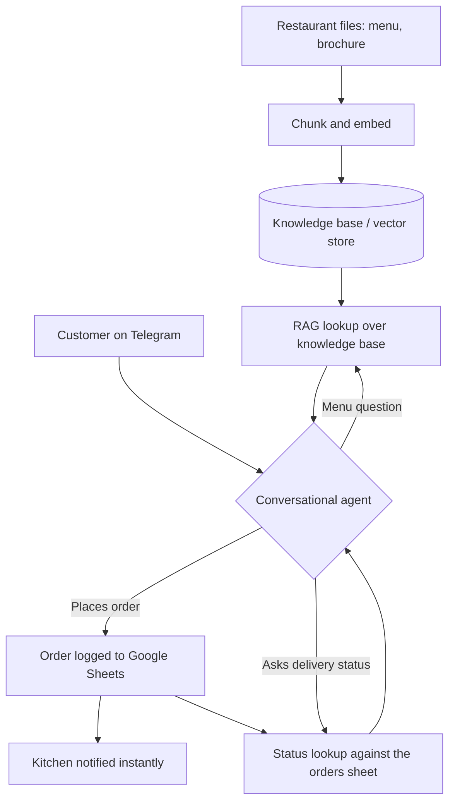

# AI Restaurant Automation

Zero-staff restaurant ordering on Telegram: customers ask about the menu, place orders, and get delivery status updates through one bot backed by a RAG knowledge base, with every order logged and the kitchen notified instantly.

**[Watch the demo](https://youtu.be/u7ePA5cPpBs)**

## The problem

Every shift, a restaurant spends staff time on the same repetitive work: answering the same menu questions, taking orders by phone or chat, relaying them to the kitchen, and fielding "where is my order" messages. Each of those touches needs a person, so busy periods turn into wait times, mistakes, and missed sales. This system moves all of it onto a single Telegram bot, so the restaurant can take and track orders without staffing the channel.

## What it does

- Answers menu questions in natural language from a knowledge base built out of the restaurant's own files (menu, brochure)
- Captures complete orders in conversation and writes them to Google Sheets
- Notifies the kitchen the moment an order lands
- Lets customers check their delivery status by asking the bot

## Architecture

## Stack

n8n, Telegram Bot API, OpenAI (chat + embeddings), RAG over a vector store, Google Sheets.

## Workflows

| File | Role |
|---|---|
| `restaurant-chat.json` | Main conversational agent: menu Q&A (RAG) + order capture + kitchen notification |
| `order-status-updates.json` | Delivery status lookups against the orders sheet |
| `kb-ingestion.json` | Knowledge-base pipeline: ingests restaurant files, chunks, embeds, and keeps the KB current |

`sample-menu.md`, `sample-menu.pdf`, and `sample-brochure.pdf` are the sample source documents the knowledge base is built from.

## Import and setup

1. Import each JSON into n8n (Workflows, Import from File).
2. Create credentials: a Telegram bot token, an OpenAI API key, and a Google Sheets connection. Credential references in the JSONs are name-only placeholders; bind your own.
3. Replace `YOUR_SPREADSHEET_ID` with your orders sheet.
4. Upload your own menu and restaurant documents through the ingestion workflow.

## Note on redaction

All credentials, webhook IDs, spreadsheet IDs, and personal identifiers have been replaced with self-describing placeholders. The workflow logic is exactly what runs in the demo.

## License

Released under the MIT License. See [LICENSE](LICENSE).

---

Built by [Moamen Elsharkawy](https://www.linkedin.com/in/moamen--elsharkawy/), AI Automation Engineer. More builds: [portfolio](https://www.notion.so/Moamen-Elsharkawy-AI-Automation-Specialist-c201df9dd81482998591011f978b1bda) | [GitHub profile](https://github.com/Moamen-Elsharkawy)
